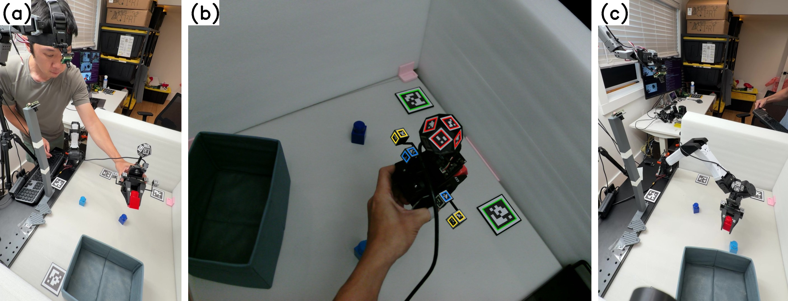
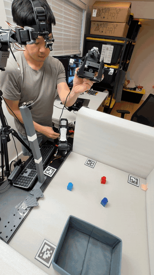
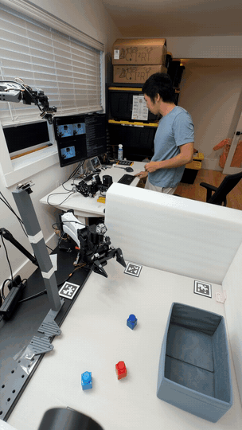

# head-cam-umi

**A head camera is (almost) all you need.** One camera worn on the collector's
head labels an electronics-free [YAM-UMI](https://github.com/YosubShin/yam-umi)
glove (6-DoF gripper pose and jaw width from printed fiducials against paper
tiles) and is at the same time the policy's observation. At deployment the same
camera rides a low-cost servo arm beside the robot that mimics the collector's
head from the robot's joint state. No wrist camera, no cable on the hand, no
IMU, no SLAM, no fixed tracker, and one data stream instead of three.

> **Paper:** [A Head Camera Is (Almost) All You Need: An Electronics-Free UMI Glove Labelled and Observed by One Moving Camera](https://arxiv.org/abs/2610.27622)
> (arXiv:2610.27622, October 2026; submitted to the CoRL 2026 workshop *The UMI Arena*) ·
> [PDF](paper/main.pdf) · [LaTeX source and figures](paper/) ·
> [rollout grid log](rollout_logs/grid_20261016/trials.jsonl)

  

<em>One camera, two mounts. (a) The collector wears the camera and holds the electronics-free glove over the tiled workspace.
(b) The camera's own frame: tiles (green), ball (red) and jaw tags (blue, yellow) give the pose and the jaw width.
(c) The same camera on a six-joint positioner beside the robot during a rollout. The wrist fisheye on the glove and the fixed camera on the post serve the ablations only.</em>

  
  &nbsp;&nbsp;
  

<em>Left: one glove demonstration at 1.5× (click for the <a href="media/head-collection-clip.mp4">clip</a>).
Right: one placement-grid trial of the co-trained head-camera policy at 2.5× (<a href="media/head-rollout-clip.mp4">clip</a>); the positioner on the left keeps the gripper in view.</em>

| | |
|---|---|
| **On the hand** | a $22 printed replica of the YAM gripper carrying fiducials and nothing else; no camera, no cable, no battery |
| **On the head** | one Arducam B0587 4K camera ($122) on a $10 GoPro head strap: 103 g worn, 37 g of USB cable |
| **Streams** | one. The head camera is the policy observation *and* the source of pose and jaw width; nothing to synchronise or cross-calibrate |
| **Labels** | tool pose within 6.5 mm / 1.6° median of the robot's encoders (14.1 mm / 2.7° p90), 93–100 % of frames; jaw width within 3.5 % of stroke (2.3 % closed) |
| **Throughput** | 2.0–3.1 demonstrations per minute, against 1.6 by teleoperation on the same task, without robot time |
| **Deployment** | the same camera on a six-joint SO-101 arm ($122 in servos) that parks at the collector's median head pose and follows the gripper from joint state alone |
| **Rollouts** | co-trained head-camera policy 20/25 vs 15/25 for the wrist-camera UMI recipe and 12/25 for a fixed camera; 194 glove demonstrations lift 48 teleoperated episodes from 10/25 to 17/25, level with 172 teleoperated episodes (18/25) |
| **Cost** | about $154 to collect (glove, camera, strap, paper tiles) and $122 of positioner on the robot side |

> **Status:** the full system has been run end to end on one task (pick a red
> block into a bin): four glove sessions (198 demonstrations), 178 teleoperated
> episodes under the positioner, eight ACT policies and a 200-trial placement
> grid. One collector, one glove, one layout of tiles. See
> [Status and limitations](#status-and-limitations).

## The idea

Every UMI-style device answers two questions: *what does the policy see*, and
*how is the gripper tracked*? The conventional answer puts both on the wrist:
a fisheye for the observation and SLAM, an IMU, a VR controller or a fixed
external camera for the pose. Each tracker is a second stream beside the
camera, with its own clock and calibration to reconcile, and the wrist view is
tied to the hand: even through a 155° fisheye the frame holds what the jaws
face, so a drop-off bin leaves it once the hand lifts or turns.

We answer both with one head-worn camera. Gaze precedes the hand, so the head
keeps the gripper at arm's length, unoccluded by the torso, with the workspace
around it. From that vantage:

- **four AprilTag tiles** taped around the workspace give the camera pose
  (the world frame) in every frame;
- an **11-face ArUco dodecahedron** on the back of the glove gives the gripper
  pose in the camera frame;
- **tags on printed tails** on each jaw give the jaw width by a per-unit
  linear map (0.9–3.8 mm holdout RMS on calipered spacers).

At deployment a small printed servo arm beside the robot carries the same
camera and imitates head motion from the robot's joint state, identically in
teleoperation and in rollouts, so glove, teleoperated and rollout data share
one viewpoint distribution. The viewpoint model is a ridge regression from
the gripper's pose to where the collector's head went, fitted on about 100
glove episodes (held-out head-pose error 46 mm / 5.4° median, against 87 mm /
7.0° for a static camera).

  
  
  

<em>The three views compared in the paper: head camera (ours), wrist fisheye (the UMI recipe), fixed external camera (the YAM-UMI paper's tracker). The wrist fisheye and the fixed camera were recorded only for the ablations.</em>

## Results

Eight ACT policies, one task, 25 block placements each, one trial per
placement with a 60 s budget. Every arm's teleoperated half carries the
robot's encoder labels except arm 6; the glove half carries the camera under
test. "Val" is the ACT loss on 6 held-out teleoperated episodes with encoder
targets. Fails: *n* never grasped, *d* dropped before the bin, *b* dropped at
the bin, *t* timed out.

| # | Arm | Glove labels | Observation | Teleop + glove | Val | Success | Fails |
|---|---|---|---|---|---|---|---|
| 1 | teleop only | — | head cam | 172 | 0.318 | 18/25 | n5 d1 t1 |
| 2 | **the device** | head cam | head cam | 172 + 194 | **0.263** | **20/25** | n5 |
| 3 | teleop only, low budget | — | head cam | 48 | 0.464 | 10/25 | n15 |
| 4 | device, low budget | head cam | head cam | 48 + 194 | 0.295 | 17/25 | n8 |
| 5 | wrist-camera UMI | fixed cam | wrist fisheye | 168 + 253 | 0.257 | 15/25 | n6 d3 b1 |
| 6 | head-cam teleop labels | — | head cam | 172 (head labels) | 0.328 | 15/25 | n10 |
| 7 | fixed camera as system | fixed cam | fixed cam | 172 + 255 | 0.256 | 12/25 | n12 b1 |
| 8 | head labels, wrist view | head cam | wrist fisheye | 168 + 192 | 0.252 | 14/25 | n3 d7 b1 |

What the grid says, and how firmly:

- **Co-training stretches a small teleoperation budget.** 48 teleoperated
  episodes plus the glove set reach 17/25, against 10/25 without it (9
  placements won to 2 lost, exact McNemar *p* = 0.065) and 18/25 for all 172
  teleoperated episodes. By the validation curve the glove set is worth
  65–100 teleoperated episodes.
- **Head-camera labels cost little.** Teleoperation labelled by the head
  camera instead of the encoders (arm 6 vs 1) loses 3 % in validation loss and
  is within noise on the robot (15/25 vs 18/25, *p* = 0.58).
- **The view decides the failure mode.** Offline the four co-trained views
  sit within 0.011 of each other; on the robot the head camera wins 6/1, 11/3
  and 8/2 placements against the wrist, fixed and head-labels-on-wrist arms
  (*p* = 0.13, 0.06, 0.11). Wrist-view policies drop the block mid-carry (12 of
  their 21 failures, every drop while the fisheye looked away from the bin);
  head-camera policies fail only by never grasping (1 drop in 45 failures).
- **No pair clears *p* = 0.05 at 25 placements**, and only one trial per
  placement was run. The ranking is consistent across every comparison.

`paper/fig/grid_stats.py` reproduces every number above from
[`rollout_logs/grid_20261016/trials.jsonl`](rollout_logs/grid_20261016/trials.jsonl);
`grid_analysis.py` gives the full per-policy and paired report.

## Repository layout

| Directory | Contents |
|---|---|
| [`paper/`](paper/) | the paper as submitted: `main.tex`, `sections/`, figure scripts and sources in `fig/`, built `main.pdf`; [`paper/README.md`](paper/README.md) is the reader's guide |
| [`scripts/`](scripts/) | all software, one copy: camera kit, recording, detection, bundle solvers, hand-eye and base-world calibration, dataset builder, viewpoint model, SO-101 positioner, YAM teleop host, policy evaluation and grid analysis. Procedure in [`scripts/README.md`](scripts/README.md) |
| [`calib/`](calib/) | the calibration files the paper's chain used: intrinsics, ball and gripper bundles, hand-eyes, tile layout, base-to-tile link, viewpoint model, positioner kinematics, width maps, episode split lists. Inventory in [`calib/README.md`](calib/README.md) |
| [`STL/`](STL/), [`STEP/`](STEP/) | the printed parts that turn a YAM-UMI glove into this one, the robot-side ball mount and the GoPro-pattern camera adapters |
| [`markers/`](markers/) | marker sheets: glove and robot rigs, the 60 mm AprilTag tiles, the ChArUco board |
| [`docs/`](docs/) | collection runbook, camera certification gauntlet, the problems-and-fixes ledger, the hand-off doc for a second unit, the head-round validation curves (`docs/results/`) |
| [`rollout_logs/grid_20261016/`](rollout_logs/grid_20261016/) | the final placement grid: `trials.jsonl` (200 scored trials), `placements.json`, `anecdotes.md` (the operator's notes). Videos and tick logs stay local |
| [`media/`](media/) | teaser, GIFs and clips |

`data/raw`, `train_runs` and `datasets_out` are symlinks to the data disk and
the LeRobot cache on the robot machine and are not in git.

## Hardware

The glove body, fingers, rails and the dodecahedral ball come from
[YAM-UMI](https://github.com/YosubShin/yam-umi); build that first, **without
its wrist camera**. This repository adds the parts that let one external
viewpoint read the jaw width, the robot-side ball mount for calibration, and
the camera mounts.

### Glove: jaw width from the head camera

The fingertip tags of YAM-UMI face the wrist camera and are edge-on from the
head, so each jaw carries a printed wedge with its own tags.

- **`aperture_tail`** attaches to a gripper tip and moves with it as the
  gripper opens and closes, carrying 12 mm AprilTags where the head camera can
  see them. The left and right tails are derived from
  `STEP/aperture_tails.step`; print `STL/aperture_tail_left.stl` and
  `STL/aperture_tail_right.stl`.
- **`gripper_back_marker_holder`** is the fixed reference the tails are
  measured against, mounted on the back of the gripper; print two (the
  `_left` and `_right` STLs are the same file).

### Head mount

A $10 GoPro head strap holds the Arducam B0587 through a printed GoPro-pattern
adapter (103 g worn, plus the 37 g USB cable). The camera is aimed once per
session using its preview at 0.5–1 m, aligning the frame centre with the
perceived centre of view.

- **`arducam_gopro_mount`** carries the B0587 board and ends in the GoPro
  two-prong pattern, so the camera clips into the head strap and into the
  positioner alike; `STEP/arducam_gopro_mount.step`.
- **`44mm_gopro_mount_extender`** is a GoPro-pattern extender for when either
  mount needs more reach; `STL/44mm_gopro_mount_extender.stl`.

### The robot's head: SO-101 camera positioner

A six-joint SO-101 follower arm (six Feetech STS3215 servos, $122 in parts)
with the gripper bracket removed; the gripper servo is reused as a wrist-yaw
joint carrying a printed GoPro-pattern mount for the same camera, so the one
camera moves between head and robot without re-mounting. Three printed parts
replace the gripper, from the wrist outwards:

- **`wrist_yaw_motor_housing`** takes the place of the gripper bracket on the
  wrist-roll output and holds the sixth STS3215 as the wrist-yaw joint; print
  `STL/wrist_yaw_motor_housing.stl`.
- **`xlerobot_soft_fin_horn_adapter`** bolts to that servo's horn and presents
  the finger mount of [XLeRobot](https://github.com/Vector-Wangel/XLeRobot)'s
  soft fin-ray gripper. It is the horn bracket extracted from XLeRobot's
  `hardware/SO101_soft_fin.stl` (Apache-2.0); print
  `STL/xlerobot_soft_fin_horn_adapter.stl`.
- **`finger_mount_to_gopro_mount`** plugs into that finger mount in place of
  the fin and presents the GoPro pattern; print
  `STL/finger_mount_to_gopro_mount.stl`. The camera's `arducam_gopro_mount`
  clips in here, with the extender between them if more reach is needed.

Its kinematics are fitted once from 60 tile-verified poses
(`so101_cam_kin.py`, 7 mm / 0.7° residual). At each session start it parks at
the collector's median head pose and registers against the tiles; during
teleoperation and rollouts it follows the gripper from the YAM's joint state
through the viewpoint model (`so101_cam_track.py`). It lags about 0.4 s and
holds the camera within 16 mm median (34 mm p90) of the viewpoint model's
target.

### Ground truth on the robot

To fit the base-to-tile link and to measure label accuracy, the same
dodecahedral ball is mounted on the YAM arm so the tracked pose can be
compared against the robot's forward kinematics.

- **`wrist_stalk_adapter_v3`** mounts the ball's stalk on the robot arm.
- **`retainer_radial_tab`** holds the ball on the robot-arm stalk.

### Markers

Print every sheet at **100 % / actual size** and check the 100 mm bar with
calipers before cutting anything.

| Sheet | Contents |
|---|---|
| `markers/glove_markers_v4.pdf` | Glove rig. `DICT_4X4_100` IDs 25–49 (ball, tails, back) and AprilTag 16h5 tip IDs 2 and 3. Same file as in YAM-UMI's `pos-tracking/` |
| `markers/robot_markers_v4.pdf` | Robot rig. `DICT_4X4_100` IDs 0–24 and AprilTag 16h5 tip IDs 0 and 1 |
| `markers/apriltag_36h11_60mm_marker_75mm_tile_final.pdf` | AprilTag 36h11 IDs 0–5, 60 mm markers on 75 mm tiles: the workspace tiles (use IDs 1–5; never place tag 0) |
| `markers/charuco_letter_8.5x11.pdf` | ChArUco board, US Letter, for intrinsics |

The robot and glove sheets share one layout, and the glove IDs are the robot
IDs plus 25, so both rigs can be in view at the same time. Tape four tiles
around the workspace so that at least one, preferably two, is in the head
camera's frame whenever the glove is; tape the tile bottoms down so they are
not bumped.

## Software

Everything runs from the repository root (`python scripts/...`) and reads and
writes `calib/` and `data/raw/` relative to it. The step-by-step procedure,
gotchas and command index are in [`scripts/README.md`](scripts/README.md).

**Collection kit** (no robot): camera focus and intrinsics, glove-session
recording with episode marks and width holds, parallel marker detection, the
ball and gripper bundle solvers, per-frame camera pose from the tiles, the
session health check.

**Robot side:**

| Step | Script |
|---|---|
| YAM teleoperation host and recorder | `yam_zmq_host.py`, `record_yam_teleop.py` |
| Hand-eye (camera ↔ base, flange ↔ ball) from any session | `handeye.py`, `handeye_run.sh` |
| Base ↔ tile-world link from the head camera | `base_world_fit.py` |
| Glove ball → virtual flange | `glove_tool_frame.py` |
| Per-frame head-camera pose from the tiles | `head_pose_fast.py`, `tile_solver.py` |
| LeRobot dataset from recordings + labels (joint actions via IK) | `build_dataset.py` |
| Viewpoint model (where the head goes, from the gripper pose) | `head_residual_data.py`, `head_residual_fit.py` |
| SO-101 positioner: kinematic fit, park, track | `cam_arm_poses.py`, `so101_cam_kin.py`, `so101_cam_park.py`, `so101_cam_track.py` |
| Policy rollouts and the placement grid | `evaluate_yam.py`, `eval_grid.py`, `camera_realign.py` |
| Validation curves and grid statistics | `val_curve.py`, `grid_analysis.py`, `paper/fig/grid_stats.py` |

Environments: the kit needs only `scripts/requirements.txt` (OpenCV contrib,
NumPy, SciPy) plus ffmpeg and v4l-utils. The robot side runs in a
[LeRobot](https://github.com/huggingface/lerobot) environment with our
[lerobot_alohamini](https://github.com/YosubShin/lerobot_alohamini) fork
checked out (set `LEROBOT_ALOHAMINI` if it is not at `~/lerobot_alohamini`;
the YAM scripts import its AlohaMini helpers), and the YAM's forward
kinematics come from the [i2rt](https://github.com/i2rt-robotics/i2rt) SDK.
Policies are ACT in LeRobot, 50k steps, joint-space actions, best checkpoint
by validation loss on the held-out teleoperated episodes
(`docs/results/head_val_curves.csv`).

## Status and limitations

- **One task, one collector, one glove, one tile layout.** Every session was
  recorded by one person; a second collector, a second seed and a second task
  are the next controls.
- **Statistics.** 25 placements with one trial each separate the views in
  failure mode and ranking but leave every paired test at *p* ≥ 0.06.
- **Tiles.** A label needs a tile in view as well as the glove, so coverage
  depends on where the tiles are placed. The layout is refined by median
  single-tile poses rather than a full bundle adjustment.
- **Positioner.** Lags 0.4 s and hits joint limits on wide sweeps; its
  viewpoint model is a linear fit on one session with no tuning against
  rollouts. The jaws were often occluded by the robot's wrist-camera
  bracket, which stayed on only for the wrist-view ablations; removing it is
  the cheapest next gain.
- **Glove-only policies do not transfer** (validation 0.52 against 0.26
  co-trained): the head camera sees the collector's forearm and fingers.
  Co-train with teleoperated episodes.
- **Away from the robot.** The tile-to-base link was fitted with the robot
  holding the ball; a workspace with no robot can leave it free per session,
  as UMI-style pipelines do with relative trajectories.
- **Bimanual.** Nothing is single-handed: a second glove with its own tag IDs
  is read by the same camera, and one positioner serves both arms. Not yet
  built.

## Related work

[UMI](https://umi-gripper.github.io/) put the camera and the tracker on the
wrist; [YAM-UMI](https://github.com/YosubShin/yam-umi) kept the wrist camera
and tracked the ball with a fixed external camera, which this work replaces.
[EgoMimic](https://egomimic.github.io/) co-trains on egocentric human video
with the hand pose estimated from the video; our collector holds a replica of
the robot's gripper, so contact and jaw width are the robot's.

## License and attribution

MIT. See [LICENSE](LICENSE). The glove body and the marker ball are YAM-UMI
parts (MIT). If you use this work, cite the paper (`paper/refs.bib` has the
entry for YAM-UMI; the arXiv entry for this paper will be added once the
listing is live).
